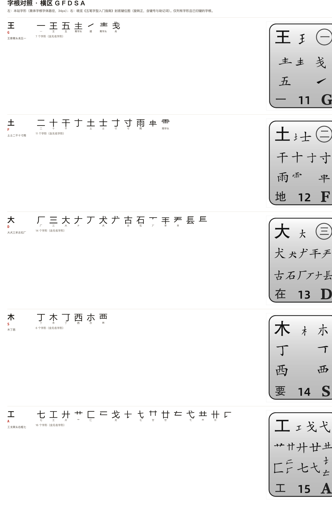
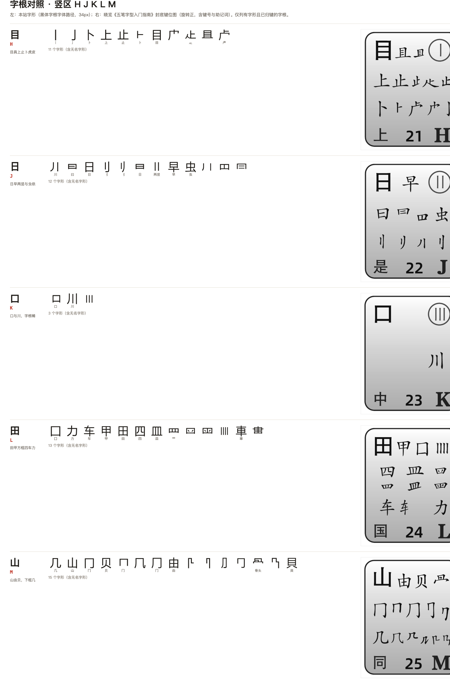
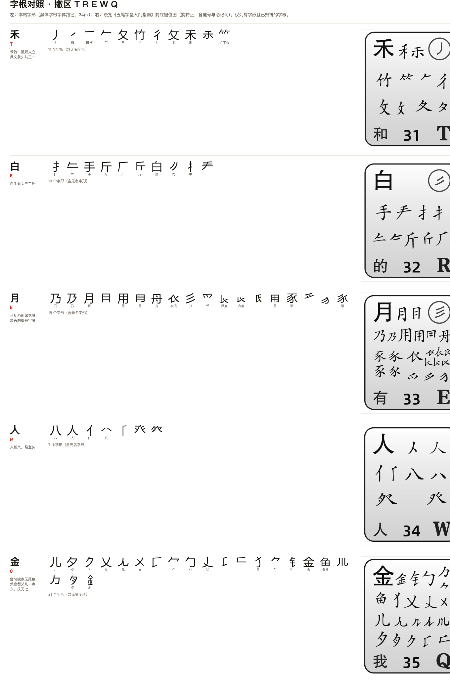
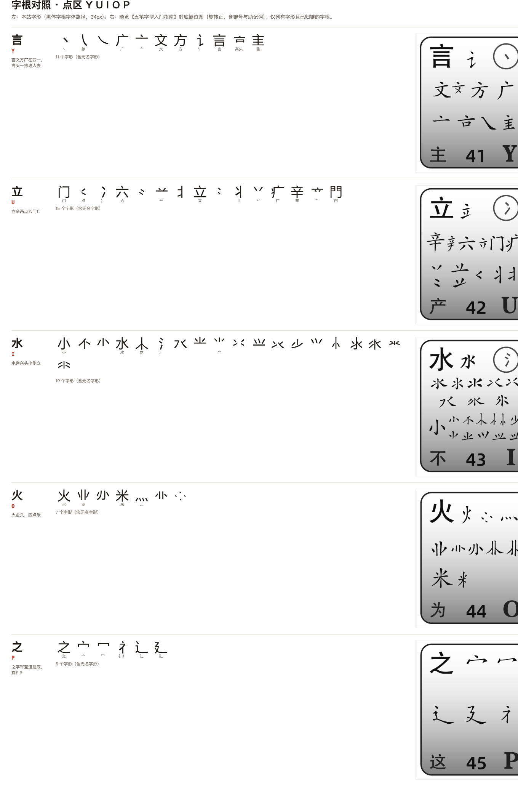
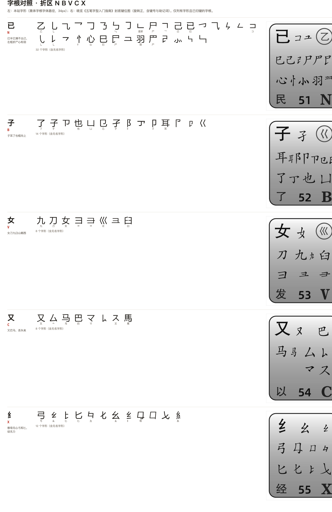

# 字根对照图（本站 vs 书中）

每个区一张，共 5 张。每行一个键：

- **左**：本站字形（`public/data/roots.json` 的 SVG 路径，黑体字根字体，34px，下方小字为字根名称）；
- **右**：晓览《五笔字型入门指南》封底键位图的键框裁切（旋转正，含键号、字根与助记词）。

| 区 | 图 |
| --- | --- |
| 横区 G F D S A |  |
| 竖区 H J K L M |  |
| 撇区 T R E W Q |  |
| 点区 Y U I O P |  |
| 折区 N B V C X |  |

说明：

- 只列出**有字形且已归键**的字根；6 个无键位变体（夕/夂、阝、讠、巛、辶、廴）和 15 个识别码字根不在图中。
- 图中「左」侧是无名字形时，下方不显示名称；可对照右侧书图判断它对应哪个字根。
- 发现差异时，记录：键位 + 左侧第几个字形 + 右侧对应字形即可。

生成脚本：`scripts/` 之外的临时脚本（基于 PDF 第 20 页矢量路径与 `roots.json`），可按需重跑。
